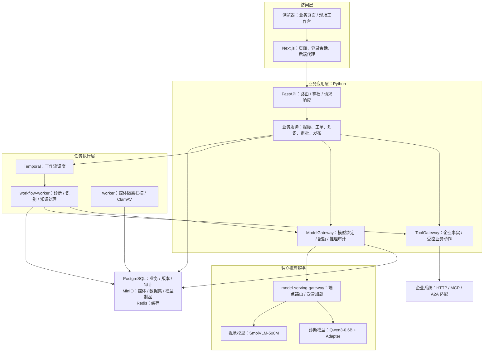

# 企业级多模态工业设备智能运维与售后 Agent 平台

面向设备报障、故障诊断、维修履约和售后数据反馈的全栈项目。它把现场图片与文本、企业知识和业务系统事实接入模型推理，再通过人工确认、审批与工单完成业务闭环。

项目由 **sunsetzt** 开发。第三方、上游和既有贡献的权利仍以各自声明及 Git 历史为准；本署名不替代许可证。[pyproject.toml](pyproject.toml) 当前声明为 `Proprietary`。

## 项目能力

页面是否可操作取决于登录主体、租户、业务状态及对应服务是否配置完成。根路径 `/` 跳转到 `/workspace`；未登录时进入 `/login`。

| 业务域 | 主要能力 | 页面入口 |
|---|---|---|
| 工作台与设备 | 角色工作台、设备选择、设备族配置 | `/workspace`、`/assets/select`、`/device-families` |
| 报障与诊断 | 故障草稿、上传、识别复核、引用溯源、诊断与复诊 | `/incidents/new`、`/incidents` |
| 维修履约 | 服务授权、报价、派工、接单、现场记录、完工、独立验收、关闭 | `/entitlements`、`/dispatch`、`/field`、`/work-orders` |
| 审批与售后 | 高风险提案审批、采购/退款/通知回执、客户确认、异常对账 | `/approvals`、`/portal`、`/reconciliations`、`/parts` |
| 企业知识与检索 | 文档录入与上传、审核、索引发布、GraphRAG、搜索 Profile、外部检索 | `/ai/knowledge`、`/ai/knowledge/graph`、`/ai/knowledge/search` |
| 数据与模型 | 数据治理、标注复核、数据集快照、实验、评测、提示词、发布与部署 | `/ai/datasets`、`/ai/experiments`、`/ai/prompts`、`/ai/releases` |
| 预测维护与规划 | 遥测接入、趋势/异常候选、时序 Transformer、RUL、维护方案与匿名评审 | `/predictive-maintenance`、`/maintenance-planning` |
| 治理与运维 | 租户权限、安全审计、紧急只读访问、恢复、供应链、成本、追踪、GPU 运维 | `/tenant`、`/security`、`/ops` |

这些能力不需要一次启动全部加载。数据平台、训练、语音、图检索和生产基础设施各有依赖；小模型图片诊断链路不代表所有专项模型均已部署。

## 项目架构

项目采用**模块化业务后端 + 独立任务进程 + 独立模型服务**：多数业务模块位于同一个 Python 包中，共享运行时组装与持久化基础。它不是"每个业务目录对应一个微服务"，也不是浏览器直接调用模型的聊天应用。下图是主要逻辑依赖，不是容器数量图。



PaddleOCR 由识别 Worker 中的 Release-bound Provider 执行，不是图中的 VLM 推理端点。Neo4j、OpenSearch、实时音视频与数据训练平台按功能另行接入，不是小模型诊断的必备组件。

| 进程 / 服务 | 主要职责 | 代码入口 |
|---|---|---|
| `web` | 页面、服务端登录会话、API 代理；不是模型运行进程 | `web/app/`、`web/lib/auth/` |
| `api` | HTTP API、业务状态变更、查询、任务提交和事件流 | `main.py` → `runtime.py` → `api/app.py` |
| `worker` | 扫描隔离媒体、记录扫描结果；不负责诊断生成 | `media/runner.py` |
| `workflow-worker` | 消费 Temporal 任务，执行诊断、识别、知识与规划 Activity | `orchestration/runner.py` |
| `model-serving-gateway` | 推理请求路由；受管路径协调模型加载/卸载 | `model_gateway/router_runtime.py`、`owned_runtime.py` |
| 事件与数据任务 | 反馈/遥测消费、Airflow 编排、Spark 处理、快照发布与血缘上报 | `event_worker/`、`data_pipeline/`、`airflow/dags/` |
| 训练/评测/部署 | 执行已登记任务，写回制品与指标；不在用户诊断时重新训练 | `training/`、`evaluation/`、`deployment/cli.py` |

未带 `web/`、`airflow/` 等前缀的路径均相对于 `src/industrial_ops_agent/`。

**三条独立链路：**

- **在线业务**：报障/上传 → 隔离扫描 → OCR/VLM 候选 → 人工确认 → 授权知识与企业事实检索 → LLM 诊断 → 审批、维修、独立验收和关闭。扫描、识别、确认、诊断是不同状态，不能互相代替。
- **数据反馈**：工单关闭 → Outbox → Debezium/Kafka → 治理、脱敏、标注 → Airflow/Spark → Parquet + Manifest → OpenLineage → 数据集快照。
- **模型迭代**：已授权快照 → 实验/MLflow → 训练制品 → 独立评测 → Release/审批 → Deployment/路由激活 → 新请求使用绑定的模型和提示词。

三条链路共享业务标识和版本记录，但执行时机独立：一次诊断不会自动触发训练，生成一个 Adapter 也不会自动替换在线模型。

**贯穿各层的机制：**

- **身份与租户**：NextAuth / Keycloak 管理登录，API 校验身份并结合 OPA 判定权限；SQLAlchemy 事务设置租户上下文，PostgreSQL RLS 与业务授权共同限制数据访问。
- **动作与证据**：ToolGateway 对读取、提案与执行分别授权，保留幂等、审批、外部回执和对账；模型建议不是执行凭证。
- **配置与密钥**：`Settings` 管理配置，SecretProvider / Vault 提供密钥。
- **可观测性**：请求标识、Agent 事件、推理审计与 OpenTelemetry 串联业务过程；Prometheus/Grafana、Tempo、Loki 和可选 Langfuse 承接指标、日志与追踪。

## 代码结构

```text
.
├── pyproject.toml / uv.lock       # Python 包、CLI、可选依赖及版本锁定
├── pnpm-workspace.yaml / pnpm-lock.yaml   # 前端工作区与依赖锁定
├── Makefile                       # 常用命令入口
├── compose.lite.yaml              # 基础业务与基础设施
├── compose.real-model.yaml        # 真实模型服务与业务连接覆盖层
├── compose.integration.yaml       # 数据、训练、评测等集成服务
├── compose.realtime.yaml          # 实时媒体扩展
├── compose.observability.yaml     # 可观测性扩展
├── src/industrial_ops_agent/      # 后端、Worker、训练与模型运行代码
│   ├── main.py                    # API 进程启动
│   ├── runtime.py                 # 数据库、授权、网关等运行依赖组装
│   ├── config.py                  # 配置定义与校验
│   ├── api/                       # FastAPI 应用、路由、依赖和错误转换
│   ├── application/ / domain/     # 报障、诊断等应用用例与领域结构
│   ├── persistence/               # ORM、事务与持久化记录
│   └── orchestration/             # Temporal 工作流与 Activity
├── web/                           # Next.js 前端与服务端 API 代理
├── alembic/versions/              # 数据库结构演进
├── airflow/dags/                  # 数据流水线调度定义
├── scripts/                       # 启动、制品打包、绑定和运维辅助
├── docker/                        # 各进程镜像定义、依赖锁和启动脚本
├── infra/                         # Helm、Terraform、KServe、Vault、OPA 等配置
├── contracts/                     # OpenAPI、事件 Schema
└── acceptance/                    # 业务闭环验收清单等输入
```

后端业务模块均位于 `src/industrial_ops_agent/`。业务规则分布在各业务包的 `service.py` 及相关模块中，没有包揽所有业务的 `services/` 目录：

| 模块组 | 主要目录 |
|---|---|
| HTTP 与应用用例 | `api/`、`application/`、`domain/` |
| 维修与售后 | `workorders/`、`parts/`、`service_entitlements/`、`customer_portal/`、`incident_operations/`、`service_performance/` |
| 受控工具与审批 | `tools/`、`tool_governance/`、`approval/` |
| Agent 与任务编排 | `agent/`、`orchestration/` |
| 知识与检索 | `knowledge/`、`graph_rag/`、`search_profiles/`、`external_search/`、`memory_governance/` |
| 媒体与多模态 | `media/`、`multimodal/`、`realtime_media/` |
| 推理与提示词 | `model_gateway/`、`guardrails/`、`prompting/`、`prompt_governance/` |
| 实验、训练与发布 | `experiments/`、`training/`、`evaluation/`、`releases/`、`deployment/`、`supply_chain/` |
| 数据反馈与治理 | `eventing/`、`event_worker/`、`data_governance/`、`labeling/`、`data_pipeline/` |
| 预测维护与设备 | `predictive_maintenance/`、`device_families/`、`edge/` |
| 身份与安全 | `auth/`、`security/`、`tenant_administration/`、`security_audit.py` |
| 持久化与运维 | `persistence/`、`object_store/`、`cache/`、`operations/`、`recovery/`、`config.py`、`secrets.py` |

前端页面 URL 来自 `web/app/`（Next.js App Router）；业务请求集中在 `web/lib/api/client.ts`，通过 `web/app/api/backend/[...path]/route.ts` 转发到后端，代理从服务端会话取得访问令牌并转发幂等、版本和追踪头。`web/generated/api/schema.d.ts` 是 OpenAPI 生成类型，不是手写业务逻辑。

**用一次诊断串起代码：**

| 环节 | 实际代码与行为 |
|---|---|
| 页面提交 | `web/lib/api/client.ts:startDiagnosis` 发起请求，经 Next.js 后端代理进入 API |
| API 接入 | `api/routes/diagnoses.py:start_diagnosis` 解析请求、身份与版本条件，调用应用服务 |
| 创建任务 | `application/diagnoses.py:DiagnosisService` 校验权限、幂等和模型绑定，保存状态并提交工作流 |
| 异步执行 | `orchestration/runner.py` 注册 Worker；`DiagnosisWorkflow` 执行 `DiagnosisActivity` |
| 整理依据 | Activity 从知识检索、企业工具和授权业务上下文获取事实，按 Manifest 绑定提示词 |
| 模型生成 | Activity 调用 `ModelGateway`，经匹配端点获取输出，校验结构、引用和执行结果 |
| 结果展示 | 结果、Agent 事件与检查点写回；页面通过查询/事件流显示进度，后续业务动作另行确认 |

`agent/graph.py` 中有 LangGraph 实现，但当前正式诊断的实际模型调用位于 `DiagnosisActivity`。排查"页面为什么没有调用模型"应沿以上链路定位，不能只看图定义或模型容器是否启动。

## 大模型、OCR 与微调

| 组件 | 业务职责 | 实现与绑定 |
|---|---|---|
| PaddleOCR | 从铭牌、报警截图和文档中提取文字 | `ReleaseBoundOcrProvider` 校验 Release 组件，再执行真实 OCR |
| SmolVLM-500M-Instruct | 静态图片中的视觉观察候选 | `GatewayVlmProvider` → Gateway 的 `VLM` 请求；固定来源见 [SmolVLM 清单](infra/model-runtime/smolvlm-500m.json) |
| Qwen3-0.6B + 微调 Adapter | 综合故障描述、授权引用与企业事实，生成结构化诊断 | `DiagnosisActivity` → Gateway 的 `DIAGNOSIS` 请求；实际 Adapter 由部署制品绑定 |
| Prompt Bundle | 规定任务、风险处理、变量与输出结构 | [版本注册表](src/industrial_ops_agent/prompting/registry.py) 与 Release Manifest 共同绑定 |

微调不是每次诊断都重新训练：训练 Worker 事先生成 Adapter，部署时加载基础模型和 Adapter，业务请求使用部署后的版本。[受管运行时](src/industrial_ops_agent/model_gateway/owned_runtime.py)支持串行加载/卸载，降低模型同时驻留的需求；当前 SmolVLM 路径限制单张图片、不接收视频。模型服务节点需要匹配的 GPU 环境，而浏览器、Web、API、数据库并不都需要 GPU。

**环境与真实调用的判断：**

- 暂存：`IOAP_MODEL_GATEWAY_REQUIRED_ENVIRONMENT=STAGING`，诊断与图片别名为 `industrial-diagnosis-staging`；生产为 `PRODUCTION` 与 `industrial-diagnosis`。
- 当前配置拒绝旧的 `IOAP_MODEL_GATEWAY_ENABLED`、`IOAP_MODEL_GATEWAY_TRANSPORT`、`IOAP_OCR_PROVIDER` 及旧 Ollama 选择参数，不要从历史说明复制。
- OCR、VLM、诊断必须匹配目标租户、Release、Manifest、Deployment 和端点；缺少证据时返回具体失败，不用固定答案补成功。
- 查看绑定用 `GET /api/v1/model-gateway/runtime-status`、`/routes`；推理记录在 `GET /api/v1/model-gateway/inferences`。服务 `READY`、识别确认或训练完成都不能单独证明一次业务已使用新模型。

## 快速开始

命令在 Linux / WSL 的仓库根目录执行。

| 用途 | 仓库要求 |
|---|---|
| 后端开发 | Python 3.11～3.13、uv；见 [pyproject.toml](pyproject.toml) 与 [uv.lock](uv.lock) |
| 前端开发 | Node.js 22 或更高、pnpm 11.20.0；见 [web/package.json](web/package.json) |
| 容器与脚本 | Docker Compose 插件、Bash、make、curl、zip |
| 本地真实模型 | NVIDIA 驱动、`nvidia-smi`、容器 GPU 支持、匹配的模型镜像与制品 |

```bash
uv sync --locked --extra dev --extra data-pipeline
pnpm --dir web install --frozen-lockfile
make m1-init          # 生成 .env.m1.local（0600）；不下载模型、不训练、不建 Release
make m1-up            # 已有标准部署时使用
make m1-status
```

| Compose 文件 | 用途 |
|---|---|
| [compose.lite.yaml](compose.lite.yaml) | Web/API、扫描与工作流 Worker、PostgreSQL、Redis、MinIO、Keycloak、Vault、ClamAV、OPA、Temporal；名称 Lite 不代表单进程或轻量依赖 |
| [compose.real-model.yaml](compose.real-model.yaml) | GPU 模型、模型路由和业务别名覆盖；需要实际镜像、模型路径、密钥和已登记绑定 |
| [compose.integration.yaml](compose.integration.yaml) | Kafka/Debezium、标注、Airflow/Spark、血缘、MLflow、训练/评测 Profile |
| [compose.realtime.yaml](compose.realtime.yaml) / [compose.observability.yaml](compose.observability.yaml) | 实时媒体；OTel、Prometheus、Grafana、Tempo、Loki |

**不要直接叠加旧的 [compose.ai.yaml](compose.ai.yaml)**：它仍设置已被 `Settings` 拒绝的旧模型开关。需要 PaddleOCR 时应在部署覆盖层选择具备 `local-ai` 依赖的 [AI Worker 镜像](docker/ai-worker.Dockerfile)，基础工作流镜像并不包含完整 PaddleOCR 环境。

本仓库**不是"克隆后执行一个命令即可获得完整模型业务"的安装包**。首次部署还需：准备基础服务与私密配置并执行数据库迁移（[migrate.py](src/industrial_ops_agent/migrate.py)）；准备 Qwen3-0.6B 与 Adapter、SmolVLM 固定 revision、OCR 资源和模型卷（仓库不携带这些运行制品）；通过授权 API/工作台把模型与评测证据登记到**业务租户**并完成 Release、审批和 Deployment；使 Release/Manifest/端点/配额一致后启动业务 Worker。已有实例必须沿用相同的项目名、完整 Compose 文件列表、顺序、镜像及卷挂载。

| 服务 | 默认地址 / 端口参数 |
|---|---|
| 业务页面 | <http://localhost:3000> / `M1_WEB_PORT` |
| API | 真实模型覆盖层映射 <http://127.0.0.1:8000> / `M1_API_PORT` |
| Keycloak | <http://localhost:8080> / `M1_KEYCLOAK_PORT`，Realm `industrial-ops` |
| MinIO 控制台 | <http://localhost:9001> / `M1_MINIO_CONSOLE_PORT` |
| Label Studio / Airflow / MLflow | 集成部署后分别为 8081 / 8082 / 5000 |

共享或远程访问时同步配置 Web 的 `NEXTAUTH_URL`、Keycloak issuer/回调、API 可达地址及媒体 Origin，使用 HTTPS/WSS。当前代码在非生产环境开放 `/docs` 和 `/openapi.json`，`IOAP_ENVIRONMENT=production` 时关闭。

[本地 Realm](infra/keycloak/m1-realm.json)提供 `local-demo-admin`（多角色）、`m1-engineer`（现场工程师）、`m1-tenant-admin`（租户管理员）、`m3-data-steward`（数据治理）、`m7-after-sales`/`m7-domain-expert`（售后/领域专家）、`m6-security-auditor`/`m6-platform-operator`（安全审计/平台运维）；首次导入的本地密码取运行文件中的 `M1_DEMO_USER_PASSWORD`。多角色账号不能绕过"申请人与审批人不同""维修人与验收人不同"。

## 走通一次业务流程

先准备可用模型绑定、目标租户设备和已发布知识；以下是操作路线，不是自动验收脚本。

1. **报障**：登录后选择设备，在 `/incidents/new` 创建故障草稿，填写实际现象、时间和设备信息。
2. **上传与识别**：上传 JPG/PNG 等受支持媒体；先完成隔离扫描，再发起识别。逐项接受、修正或拒绝 OCR/视觉候选，并确认故障信息。
3. **发起诊断**：系统检索当前用户有权访问且适用于设备的知识，读取有来源及事实时间的企业数据，通过 Gateway 调用模型。报告包含结论、引用、冲突、缺失信息及后续检查；证据不足不应当作合格结论。
4. **组织维修**：根据业务授权、报价及审批创建/派发工单；有备件的路径处理出库、消耗和退料。页面按钮以服务端 `legal_actions` 为准。
5. **现场执行**：工程师进入 `/field` → 对应工单 → 接单 → 确认现场安全条件后开始，记录已完成步骤、现场证据、说明和客户签字。
6. **完工与验收**：提交根因、费用及本轮完工事实；由不同且有权限的主体验收，不通过进入返工轮次。
7. **关闭与反馈**：在授权范围内人工关闭或创建关闭提案，检查最终工单/Incident 状态及报告。关闭后的数据仍需用途授权和治理，才可能进入训练。

```text
ASSIGNED → ACCEPTED → IN_PROGRESS → COMPLETED → VERIFIED → CLOSED
                            ↑            │
                            └─ 验收不通过 ┘
```

暂停、取消、升级和改期是另外的状态/控制动作，不能靠跳过按钮顺序替代。

现场页面中几个动作的区别：

- **选择文件 / 同步本机证据**：浏览器 IndexedDB 草稿不等于服务器证据，联网同步后才进入隔离扫描。
- **可关联 / 关联现场事实**：`CLEAN` 仅表示扫描通过；点击关联后才产生工单 `EVIDENCE` 记录。
- **确认识别 / 加入 AI 观察队列**：先复核候选，再选择已接受来源并填写观察；入队不等于已同步，也不自动复诊。
- **记录步骤 / 客户签字 / 提交完工**：各自独立；当轮至少要有已完成步骤、证据和客户签字，上传图片不能替代维修记录。

默认本地企业连接使用项目沙箱。EAM/WMS/FSM、报价、通知等接口有 HTTP/MCP/A2A 接入实现，但沙箱回执不等于客户企业已接通，生产需要替换真实服务和凭据。Agent 建议不会直接控制设备。

## 数据、训练与发布

数据反馈入口为 `/ai/datasets`：用途/许可证批准 → Presidio 脱敏 → Label Studio 复核 → 固定窗口策展 → Spark/Pandera 校验 → MinIO Parquet/Manifest → OpenLineage 确认。页面的 `governance_blockers`、`training_blockers` 和 `legal_actions` 说明当前缺项；**工单关闭本身不授予训练用途**。生产不能沿用 Integration 中的固定演示凭据。

训练工作台为 `/ai/experiments`：服务端登记实验及冻结参数，Worker 按登记的方法执行，浏览器不能手填分数。训练者、独立评测者和发布审批者分别授权；训练集与冻结评测集分开保存，复用已有微调制品启动业务不需要重新训练。训练依赖见 [训练 Dockerfile](docker/training-worker.Dockerfile) 与 [量化 Dockerfile](docker/quantization-worker.Dockerfile)（独立评测使用量化工具链镜像，不要填成训练镜像的摘要）。训练/评测 CLI 的 `--dry-run` 仍会读取数据库、对象存储和身份，不是纯静态检查。

新模型与提示词切入业务的入口为 `/ai/releases`（提示词治理 `/ai/prompts`）：

1. 将实际制品及评测证据导入目标租户；跨租户导入使用 `/ai/enterprise-assets` 的现有流程。
2. 创建绑定模型组件、知识索引、Prompt Bundle、运行身份和评测证据的 Release，完成校验与独立审批。
3. 创建部署，完成对应环境的运行观察与激活；再由 Gateway 解析该版本，业务 Worker 才使用新绑定。
4. 发起新业务请求，核对其 Release、推理记录及提示词版本。**训练成功、提示词已写进源码、容器已启动都不等于切换成功。**

暂存诊断有专门的 [`STAGING_DIAGNOSIS_SMOKE_14` 接入](src/industrial_ops_agent/releases/staging_smoke.py)，读取真实登记的 14 条结果；它不修改原成绩，也不替代生产 GOLD，历史记录中的 12/14 仍应保留为 12/14。VLM/ASR 供应链补证使用 `POST /api/v1/model-releases/{release_id}/supply-chain-successor`（带 `If-Match` 与 `Idempotency-Key`）；补证创建新的 DRAFT，不改父 Manifest、成绩或审批，也不继承批准。

## 扩展能力

以下能力默认关闭，需要各自的配置、模型服务和授权证据，不会因中心诊断就绪而自动启用：

- **实时多模态**：[compose.realtime.yaml](compose.realtime.yaml) 的 `media` 与 `coturn`，API 负责会话/授权，独立媒体服务处理 RTP。会话为 `POST /api/v1/incidents/{id}/realtime-sessions`；复诊需人工接受/修订转写后显式调用 `POST /api/v1/diagnosis-runs/{id}/reanalyses`，接受转写不会自动发起诊断；播报为 `POST /api/v1/diagnosis-runs/{id}/speech`。**SmolVLM 静态图片识别与 Qwen 文本诊断可用，不代表语音或多帧推理可用。** 专家真人协作音频不进入 ASR、训练或录音存储。
- **GraphRAG**：`IOAP_GRAPH_RAG_ENABLED` 默认关闭，使用 Neo4j；候选图来自授权已发布引用，独立评测后显式激活，删除会传播到派生物。
- **OpenSearch 检索 Profile**：`IOAP_KNOWLEDGE_SEARCH_PROFILES_ENABLED` 默认关闭；候选 Profile 与原 pgvector 检索对照，评测后按代码支持的 Shadow 方式激活。
- **预测维护**：遥测经 Kafka、Schema 与时序窗口处理形成候选，人工确认后转入 Incident。
- **外部搜索与企业协作**：需配置搜索提供方、HTTP/MCP 或 A2A 端点及凭据，保留请求范围和来源记录。
- **维护方案匿名评审**：`/maintenance-planning` 的单/多 Agent 维修方案 A/B 评审，当前仅保留 `PROJECT_ADMIN_CONFIRMED`——管理员提交实际部署记录并确认后登记，再显式启用。协议只能跟踪系统内身份和读取，不等于独立密码学验收，也不等于已完成真实双人评审。

## 运行维护与排障

```bash
make m1-status
make m1-logs
./scripts/dev_lite.sh logs api workflow-worker
```

| 现象 | 优先检查 |
|---|---|
| 页面提示 Authentication required | 当前会话、令牌刷新、Keycloak issuer/回调、Web 代理；不是重新上传文件 |
| 上传后一直扫描中 | 扫描 `worker`、ClamAV、MinIO、数据库领取状态；与 VLM 生成是两条任务 |
| 模型不可用 / 路由未就绪 | `runtime-status` 原因、租户/环境/别名、Release/Deployment、配额、端点和 Vault 注入 |
| PaddleOCR 缺失 / 识别失败 | 实际 `workflow-worker` 镜像、`local-ai` 依赖、OCR 组件版本与模型资源 |
| 诊断无授权证据或结论不足 | 已发布知识索引、设备型号、访问权限、有效期及模型原始输出，不能用调低门槛代替补证据 |
| 点击加入观察后未出现现场事实 | 是否只保存在本机队列、是否联网同步、是否被服务端拒绝 |
| 完工/关闭按钮不可用 | 工单状态、当前负责人、本轮步骤/证据/签字、费用、独立验收及 `legal_actions` |
| 快照停在 LINEAGE_PENDING | OpenLineage/Marquez 回执、Debezium 复制配置、Kafka 消费及 Spark 质量结果 |
| 改了变量但没有生效 | Compose 是否插值该变量、后置覆盖层是否重写、运行容器是否使用该配置 |
| 小模型仍超时或内存不足 | 实际加载版本、上下文/并发、模型切换日志、其他常驻服务及宿主资源 |

`/health/live` 表示进程存活，`/health/ready` 表示已配置依赖检查结果；二者不代替模型推理成功记录。排障时不要转发完整请求正文、令牌或私密环境文件。

| 操作 | 影响 |
|---|---|
| 原部署 Compose 的 `stop` | 停止选定服务，保留容器和数据卷 |
| 原部署 Compose 的 `down`（不带 `--volumes`） | 移除该配置的容器和网络，保留命名卷 |
| `make m1-down` | 仅限 STAGING；停止/移除 Web、API、两个 Worker、模型路由与模型服务；基础设施仍运行 |
| `make m1-clean` | 基础 Compose 执行 `down --volumes --remove-orphans`，会删除其数据/运行密钥卷；**不是普通停机** |

清理可能丢失 PostgreSQL/身份数据、MinIO 媒体、Vault 状态和运行秘密。升级前备份数据库、对象存储、必要密钥和实际部署配置，确认新镜像与迁移兼容，再按原项目名更新受影响服务。回滚使用兼容镜像、原 Release/Deployment 和卷，不通过删库、改历史摘要或复制审批实现。

## 开发与交付

```bash
# 静态检查，不启动模型或容器
.venv/bin/ruff check src
.venv/bin/mypy src
pnpm --dir web typecheck

# 前端生产构建，会生成 .next 等产物
pnpm --dir web build

# API 契约一致性检查
./scripts/generate_openapi.sh --check
./scripts/generate_openapi_client.sh --check
```

后端入口为 `industrial-ops-api`，前端开发为 `pnpm --dir web dev`；它们仍需要实际依赖、鉴权和环境配置，不会自行初始化数据库或模型。`make web-check` 包含生产构建，不是仅做类型检查。

API 以 [contracts/openapi.json](contracts/openapi.json) 为交付契约，[web/generated/api/schema.d.ts](web/generated/api/schema.d.ts) 为生成类型；修改接口后使用现有生成脚本同步，不手改生成文件。写操作按接口要求保留版本、幂等键和错误语义。

以下入口有副作用，不要当作例行检查：

- `make m1-verify` 检查真实模型环境和已有审计，会启动 GPU 探针。
- `scripts/m3_data_verify.sh end-to-end` 写入业务/数据记录并启停离线服务。
- `scripts/model_training_sandbox.sh verify` 会实际训练/比较，结果为 `SIMULATED_NON_PRODUCTION`。
- `scripts/gpu_model_promotion_lab.sh run-all` 会训练、量化、部署并运行安全/故障场景。

## 许可证

[pyproject.toml](pyproject.toml) 当前声明为 `Proprietary`。第三方、上游和既有贡献的权利以各自声明及 Git 历史为准。
